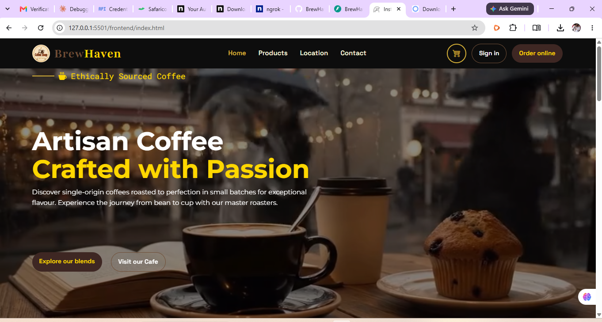
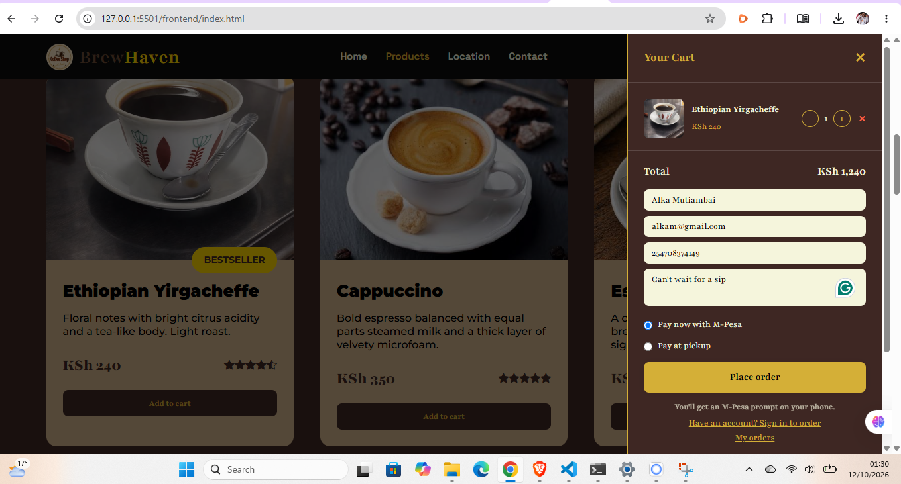
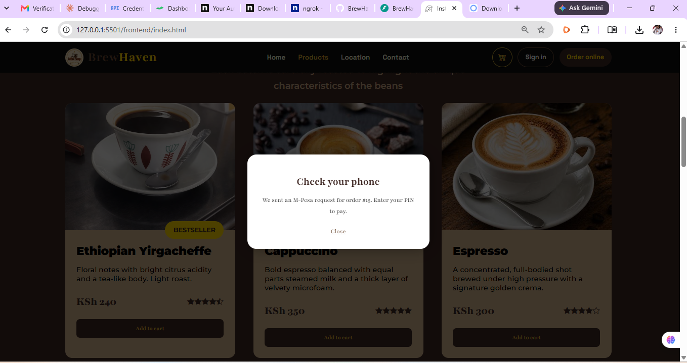
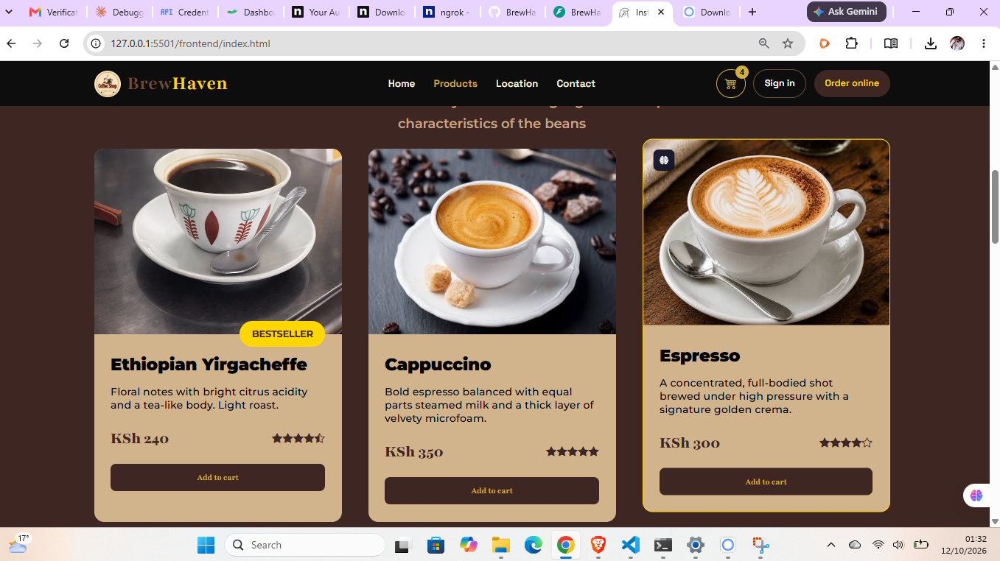
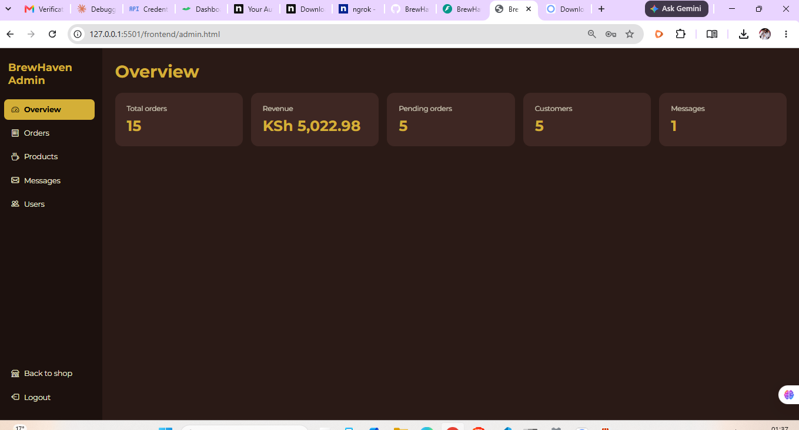

# BrewHaven: Coffee Shop Ordering Site

A full-stack coffee shop website. Customers browse the menu, fill a cart, check out as a guest or with an account, and pay with M-Pesa or cash at pickup. Staff manage orders, products, messages and users from an admin dashboard.

This is a personal learning project, built with a FastAPI backend and a plain HTML/CSS/JavaScript frontend.

**Live demo:** [brewhaven-shop.netlify.app](https://brewhaven-shop.netlify.app) | **API docs:** [brewhaven-api-rjkm.onrender.com/docs](https://brewhaven-api-rjkm.onrender.com/docs)

> The API runs on Render's free plan, so the first request after a quiet period can take about a minute, and demo data (accounts and orders) is reset whenever the service restarts. M-Pesa runs in the Daraja sandbox, so no real money moves.

<!-- Add your demo video link here once it is uploaded:
**Demo video:** [Watch the walkthrough](https://...)
-->

## Screenshots

















## Features

**Customers**
- Menu loaded from the API, with images, ratings and tags
- Cart that is saved in the browser, with quantity controls
- Guest checkout (name and phone) or sign in so orders belong to your account
- Email and password sign-up and login, plus Google sign-in
- Password reset through an emailed link
- Pay with M-Pesa (Daraja STK Push) with live payment status and a retry option, or pay at pickup
- "My orders" view with order status and M-Pesa receipt (guest orders are tracked on the same device)
- Contact form
- Email notifications for new orders and status changes (printed in the server logs when SMTP is not configured)

**Admin dashboard**
- Overview stats: orders, revenue, pending orders, users, messages
- Update order status (pending, preparing, ready, completed, cancelled); customers are emailed on key changes
- Add, edit and hide products
- Read contact messages and list users
- Admin access is decided by email address (`ADMIN_EMAILS`)

**Backend details**
- JWT authentication and bcrypt password hashing
- SQLite database; tables are created automatically and seeded with sample products on first run
- M-Pesa payments still pending after 10 minutes are marked as failed. A late callback from Safaricom can still mark them as paid.

## Tech stack

- **Backend:** Python, FastAPI, Uvicorn, SQLite, PyJWT, bcrypt, Google OAuth (`google-auth`)
- **Payments:** Safaricom Daraja API (M-Pesa STK Push)
- **Frontend:** HTML, CSS, vanilla JavaScript
- **Hosting:** Netlify (frontend), Render (API)

## Project structure

```
backend/
  main.py             FastAPI app: auth, products, orders, admin, M-Pesa callback
  mpesa.py            Daraja STK Push helpers
  requirements.txt
  .env.example        Template for your own .env
frontend/
  index.html          Shop page
  script.js           Shop logic: menu, cart, checkout, login, payments
  styles.css
  admin.html          Admin dashboard
  admin.js
  reset.html          Password reset page
  assets/
    images/
    videos/
docs/
  screenshots/        Images used in this README
```

## Run it locally

**You need:** Python 3.10 or newer, Git, and VS Code with the Live Server extension (any static file server works).

1. Clone the repo and open the backend folder:
   ```powershell
   git clone https://github.com/taliban-fr/BrewHaven--Coffee-Shop.git
   cd BrewHaven--Coffee-Shop/backend
   ```
2. Create a virtual environment and install the packages:
   ```powershell
   python -m venv .venv
   .venv\Scripts\Activate.ps1
   python -m pip install -r requirements.txt
   ```
   On macOS or Linux, activate with `source .venv/bin/activate`.
3. Create your settings file from the template and fill in the values (see the table below):
   ```powershell
   copy .env.example .env
   ```
4. Start the API:
   ```powershell
   uvicorn main:app --reload
   ```
   The API runs at `http://127.0.0.1:8000`, and the interactive docs are at `http://127.0.0.1:8000/docs`.
5. Open the repo root folder in VS Code, right-click `frontend/index.html` and choose **Open with Live Server**. The site opens at `http://127.0.0.1:5501/frontend/index.html`.

The frontend picks the API address by itself: the `API` constant at the top of `frontend/script.js` and `frontend/admin.js` uses `http://127.0.0.1:8000` when you run the site locally, and the Render API otherwise. The backend only accepts requests from the origins listed in `allow_origins` in `main.py` (the local Live Server ports 5500 and 5501, and the deployed Netlify site).

## Configuration

Settings are read from `backend/.env` locally, and from the service's environment variables when deployed. The `.env` file is ignored by Git, so your keys stay private.

| Variable | Purpose |
| --- | --- |
| `SECRET_KEY` | Signs login tokens. Use a long random value. |
| `ADMIN_EMAILS` | Comma-separated emails that get admin access. |
| `GOOGLE_CLIENT_ID` | OAuth client ID for Google sign-in. |
| `RESET_PAGE_URL` | Address of `reset.html`, used in password reset emails (for the live site, `https://brewhaven-shop.netlify.app/reset.html`). |
| `SMTP_HOST`, `SMTP_PORT`, `SMTP_USER`, `SMTP_PASSWORD`, `SMTP_FROM` | Outgoing email. Leave `SMTP_HOST` empty to print emails in the terminal or server logs instead. |
| `MPESA_ENV` | `sandbox` or `production`. |
| `MPESA_CONSUMER_KEY`, `MPESA_CONSUMER_SECRET` | From your app on the Daraja portal. |
| `MPESA_SHORTCODE`, `MPESA_PASSKEY` | Business shortcode and passkey (Daraja gives sandbox values). |
| `MPESA_CALLBACK_SECRET` | Random string that must appear in the callback URL path. |
| `MPESA_CALLBACK_URL` | Public HTTPS address Safaricom calls after a payment. |

Generate a random secret with:
```powershell
python -c "import secrets; print(secrets.token_urlsafe(32))"
```

M-Pesa checkout only appears on the site when the M-Pesa settings are present. You can check with `/config` on the API, which should show `"mpesa_enabled": true`.

## Deployment

**Frontend: Netlify**
- Import the GitHub repo, leave the base directory and build command empty, and set the publish directory to `frontend`.
- Every push to `main` redeploys the site.

**Backend: Render (Web Service)**
- Root directory: `backend`
- Build command: `pip install -r requirements.txt`
- Start command: `uvicorn main:app --host 0.0.0.0 --port $PORT`
- Add the variables from the Configuration table. Set `MPESA_CALLBACK_URL` to `https://<your-service>.onrender.com/payments/mpesa/callback/<MPESA_CALLBACK_SECRET>` and `RESET_PAGE_URL` to your frontend address plus `/reset.html`.

**Then connect the two**
- Add the frontend address to `allow_origins` in `main.py`.
- Add the frontend address to the **Authorized JavaScript origins** of your Google OAuth client.
- Make sure the `API` constant in `frontend/script.js` and `frontend/admin.js` points at the Render address.

## Testing M-Pesa in the sandbox

1. Create a Daraja account at developer.safaricom.co.ke, create an app, and copy the sandbox credentials into `.env` (or the service's environment variables).
2. Safaricom cannot reach `localhost`, so when running locally expose your API with a tunnel:
   ```powershell
   ngrok http 8000
   ```
   On the deployed API the callback address is already public, so no tunnel is needed.
3. Set the callback address, using your own secret and public address:
   ```
   MPESA_CALLBACK_URL=https://<your-public-address>/payments/mpesa/callback/<MPESA_CALLBACK_SECRET>
   ```
4. Restart the API, add something to the cart, choose **Pay now with M-Pesa**, and use the sandbox test phone number from the Daraja portal.

Sandbox payments often finish with a timeout (result code 1037), because no real phone receives the prompt. To test the successful path locally, replay a callback with `ResultCode` set to `0` from the ngrok inspector at `http://127.0.0.1:4040`. The site also asks Safaricom for the payment status on its own, so the callback is not the only way a payment gets confirmed.

## Google sign-in setup

1. In Google Cloud Console, create an OAuth 2.0 **Web application** client.
2. Add your site origins to **Authorized JavaScript origins**, for example `http://127.0.0.1:5501`, `http://localhost:5501` and your deployed site's address (such as `https://brewhaven-shop.netlify.app`). Origins must not end with a slash or contain a path.
3. Put the client ID in `.env` as `GOOGLE_CLIENT_ID` and in the `GOOGLE_CLIENT_ID` constant in `frontend/script.js`.

## API overview

| Method | Path | Purpose |
| --- | --- | --- |
| POST | `/register`, `/login`, `/auth/google` | Create an account or sign in |
| POST | `/forgot-password`, `/reset-password` | Password reset |
| GET | `/products` | Active menu items |
| GET | `/config` | Whether M-Pesa is enabled |
| POST | `/orders` | Place an order (guest or signed in) |
| GET | `/orders/mine` | Your orders |
| GET | `/orders/track/{id}?token=...` | Track an order, including guests |
| POST | `/orders/{id}/pay` | Retry an M-Pesa payment |
| POST | `/payments/mpesa/callback/{secret}` | Safaricom payment result |
| POST | `/contact` | Contact form |
| GET | `/me` | Current user |
| GET, PATCH, POST, PUT | `/admin/...` | Stats, orders, products, messages, users (admins only) |

Full details are in the interactive docs at `/docs`.

## Notes and limitations

- M-Pesa is set up for the **sandbox**. Going live needs Daraja production credentials, your own till or paybill number, and a permanent HTTPS callback URL.
- SQLite stores data in `brewhaven.db` next to `main.py`. On Render's free plan the service sleeps when idle and its disk is wiped on every restart or redeploy, so accounts and orders do not persist. Keeping data needs a persistent disk or a hosted database.
- Before taking real orders, set a strong `SECRET_KEY`, keep the CORS origins limited to your own site, and add your site's address to the Google OAuth origins.

## Ideas for next steps

- Move from SQLite to PostgreSQL so data survives restarts
- Automated tests for the order and payment flows
- Go live with M-Pesa production credentials